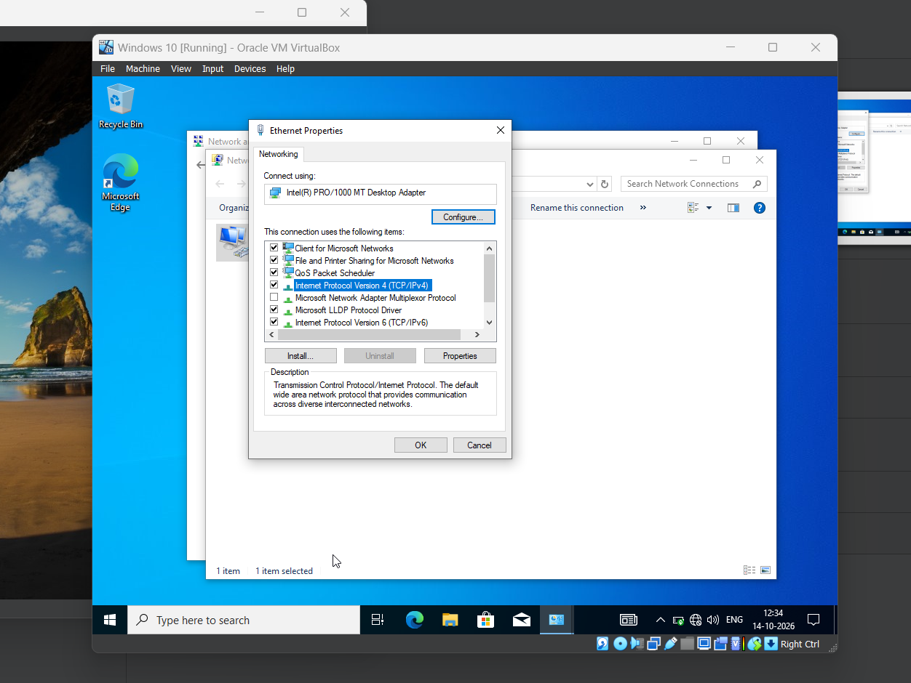
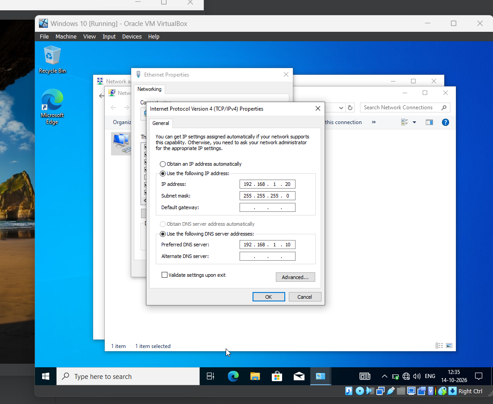
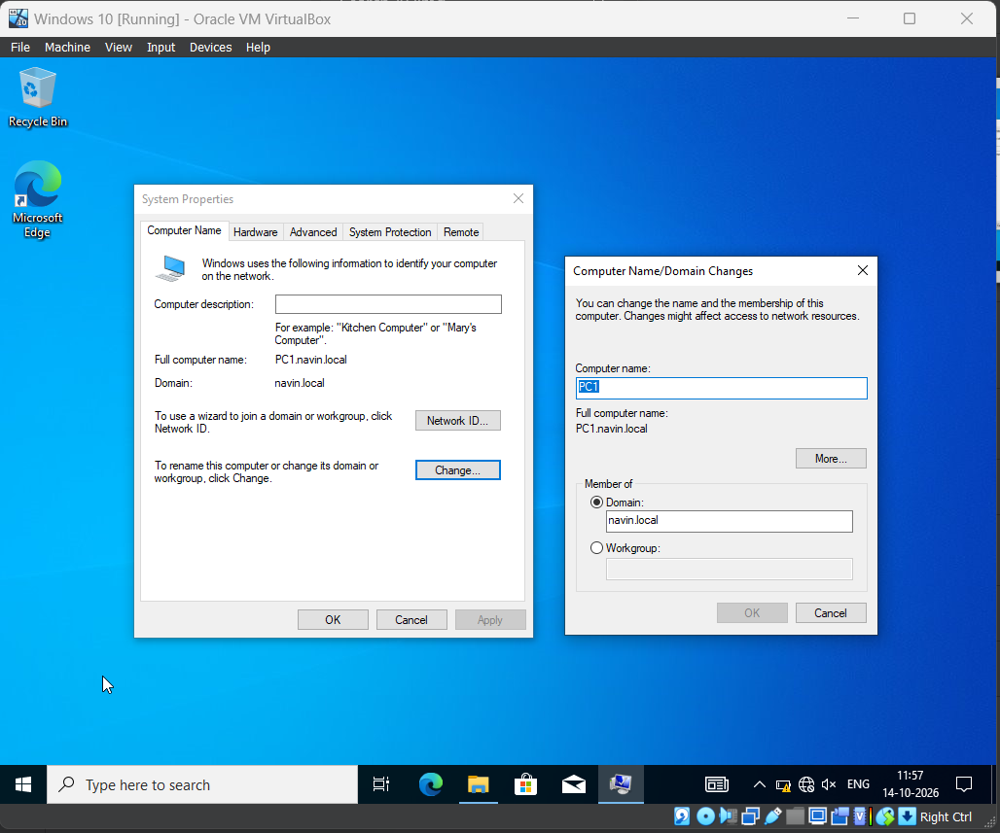
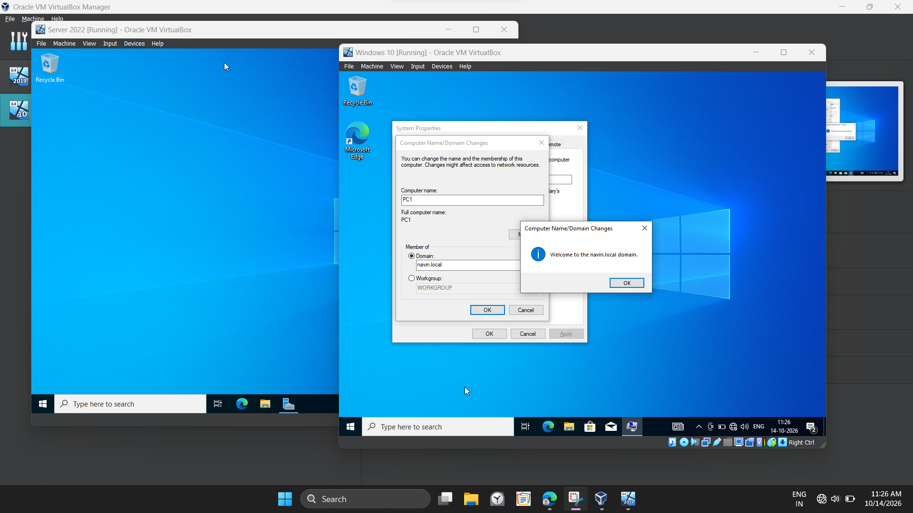
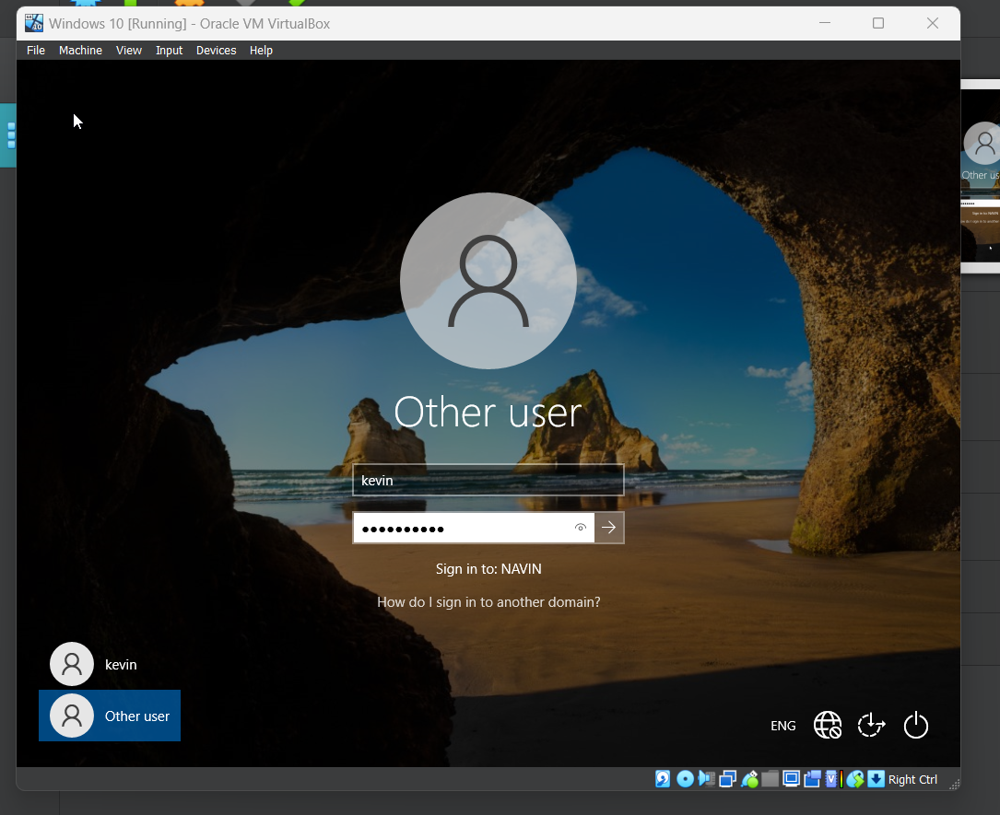

# Active-Directory
# Installing virtual box and Windows server.

- Install virtual box and creating new section for setup windows server software.
- Get windows server software from official website and assigning resource to windows server in virtual box.
- After installing and creating passwords we luanch in server dashboard where we work active directory.

# Screenshots

# Installing Active Directory Domain Service.

- Open Server Manager, click manage top right corner.
- And select add "roles and features" option.
- Select "Role based or feature based installation" option.
- Find Active directory domain service in the server roles list.
- click install. Promote this server to a domain controller.
- Add a new forest, enter domain name "navin.local".
- create password and install.

# Screenshots

# Creating user account in active directory domain service.

- Step 1: Open tools option, click Active directory user and computers.
- Step 2: Click your AD id "navin.local".
- Step 3: At bottom right click on user -> new -> user.
- Final step : Enter guest name "kevin" create password and save. check guest id was created.
- Screenshots

# Joining Windows client to Domain.

Configure DNS on the client:
- Open control panel
- Go to Network and internet -> Network and sharing center.
- Click change adapter settings
- Right-click your active network adapter and select properties.
- Double-click Internet protocol version 4.

- Set DNS server as windows server IP Address.

- Click ok.

# Join the Domain

- Press windows + r
- Type sysdm.cpl and enter.
- Open the computer name tab.
- Clink change.

- 
- 
- Select Domain
- Enter domain name "navin.local"
- Click ok
- Enter username "kevin" and password where we created before.

# Log in using account

- After restart.
- Use the user name (kevin) and passwored to login.

